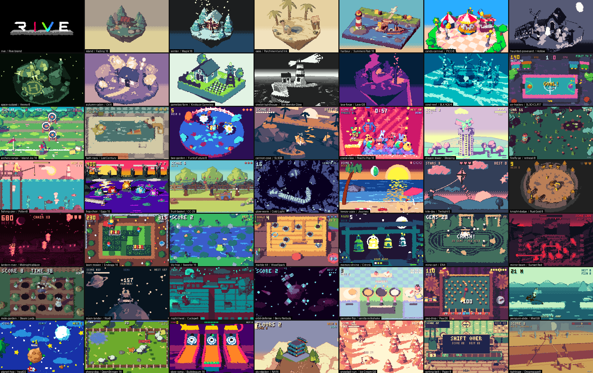

# rive_pixelart_gaussian_splat

How to render 3D scenes and games as pixel-art gaussian splats with Rive.

- **The skill**: [.claude/skills/pixel-splat-scene](.claude/skills/pixel-splat-scene/SKILL.md), the
  whole pipeline for Claude Code (and any agent that reads Agent Skills): the asset list, Lospec
  palettes and their ramps, Codex-generated low-poly turnaround sheets and textures, modelling and
  animating with `hedra model` against the sheets with measured gates and goldens, dithering,
  baking GLBs into splats (rigid and skinned animation), shader effects, cameras for any genre,
  the tested AnimaScript + WGSL renderer for the Rive CLI, and a game hook (one `game.as` per game:
  game-owned objects, pointer picking, a pixel HUD, a demo mode).
- **The examples**: [examples/dioramas/](examples/AGENT.md), diorama scenes built end to end with it, each on its
  own Lospec palette (2 to 16 colours) and its own style: a floating island,
  a winter windmill, a desert oasis, a harbour, a carnival, a graveyard, a space outpost, an autumn
  cabin, a Game Boy farm, a 1-bit lighthouse, a lava forge, a coral reef, and a Rive brand finale.
- **The games**: [examples/games/](examples/AGENT.md), 36 tiny pointer-only games, one run in one
  world each, each on its own palette, each with a demo mode that plays itself.
- **The gallery**: [examples/gallery/](examples/gallery/README.md), one Rive file holding every
  sample's signed `.riv` in a scrollable grid: tiles play in demo mode until you click one, Escape
  hands it back.

[examples/AGENT.md](examples/AGENT.md) lists the samples, their palettes and styles, and how to
work on them.



Run one: `rive examples/dioramas/winter/scene` (the live preview: drag to orbit, wheel to zoom),
`rive examples/games/<game>/scene` (play it), or everything at once: `rive examples/gallery`
(after `python3 examples/gallery/build_gallery.py`, which signs the samples; needs `rive login`).

Record the showcase video (one continuous camera turn through the dioramas, each handing over to
the next with a dithered fade, the Rive scene last, then every game playing its demo, scored with a
generated soundtrack whose downbeats land on the transitions):

```sh
cd examples && python3 tools/record_tour.py dioramas/*/scene dioramas/rive/scene -o ../showcase.mp4 \
  --seconds 10 --overlap 1.2 --hold 1.5 \
  --scene-arg dioramas/rive/scene:fxOffset=3.6 --scene-arg dioramas/rive/scene:fxStopAt=10.05 \
  --demo games/*/scene --demo-seconds 8 --music
```

Requirements: the Rive CLI 1.9+ (`rive`), hedra 0.1+ (`hedra`), the Codex CLI signed in
(`codex`), Python 3 with NumPy and Pillow, ffmpeg for the video and its soundtrack.
